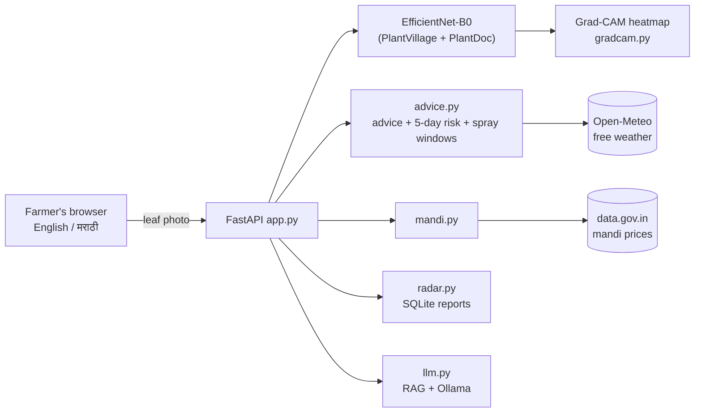

# 🌱 KisanSaathi — AI Crop Doctor for Farmers

A free, local-first, **multilingual (English / मराठी)** web app that diagnoses crop diseases from a leaf photo, explains *why*, forecasts how the disease may spread, and helps the farmer decide what to do next — built only with free and open tools.

> Built for farmers in Maharashtra. Advice is a guide, not a replacement for a local agriculture officer.


## ✨ Features

| Feature | What it does |
|---|---|
| 🔍 **Diagnosis** | EfficientNet-B0 classifier (PlantVillage + PlantDoc, 38 classes). Shows top-3 guesses and warns when confidence is low |
| 🔥 **Explainable AI** | Grad-CAM heatmap highlights the leaf area the model looked at |
| 💬 **Ask in your language** | Local LLM (Ollama) with retrieval over agriculture documents; answers about the diagnosed disease |
| 📡 **Spread-risk forecast** | 5-day High / Medium / Low risk from Kolhapur's temperature, humidity and rain, tuned to each disease type |
| 🧴 **Smart spray planner** | Finds dry, low-wind, cool spray windows and calculates water, tanks and product per tank from the label dose (acre / guntha / hectare) |
| 💰 **Prices & profit** | Live mandi prices (data.gov.in / Agmarknet) and an "is treatment worth it?" calculator |
| 🗺️ **Outbreak Radar** | Anonymous taluka-level reports plotted on a map, with alerts when a disease clusters |
| 🔊 **Listen & share** | Reads advice aloud (Marathi voice) and shares results on WhatsApp |
| 🌾 **My Farm** | Scan history stored on the device |
| 🌗 **Dark mode** | Light / dark theme, mobile friendly |

## 🏗️ Architecture



## 🚀 Run it locally

**Requirements:** Python 3.10+, [Ollama](https://ollama.com) with `llama3.2:3b` pulled.

```bash
git clone <your-repo-url>
cd kisansaathi-app
python -m venv venv
venv\Scripts\activate          # Windows  (Linux/Mac: source venv/bin/activate)
pip install -r requirements.txt
uvicorn app:app --reload
```

Open **http://127.0.0.1:8000**

**Model file:** `combined_model.pth` is not stored in this repo (too large). Place your trained checkpoint next to `app.py`.

**Optional — live mandi prices:** get a free key at [data.gov.in](https://data.gov.in), then save it in a file named `data_gov_key.txt` (already git-ignored). Without it, prices can be typed manually.

## 🔌 API

| Method | Route | Purpose |
|---|---|---|
| POST | `/predict` | Image → diagnosis, heatmap, advice, weather, risk |
| POST | `/ask` | Question (+ disease) → answer |
| GET | `/spray-windows` | Best spray times (next 3 days) |
| GET | `/mandi?commodity=Tomato` | Latest Maharashtra mandi price |
| POST | `/radar/report` | Add an anonymous outbreak report |
| GET | `/radar/summary` | Aggregated reports and alerts |

## 📂 Project structure

```
app.py          FastAPI routes
gradcam.py      Grad-CAM explainability
advice.py       Disease advice (EN/MR), risk forecast, spray windows
mandi.py        Live mandi prices
radar.py        Outbreak Radar storage (SQLite)
llm.py          Ollama + retrieval
index.html      Single-page UI
train_finetune.py   Fine-tune on field-style photos
```

## ⚠️ Limitations

- Accuracy on real field photos is **67.4%** (PlantDoc test set). Lab-style photos score much higher, so results on messy field photos can be unreliable — the app warns when confidence is low.
- Disease advice is general guidance by disease type; always confirm sprays with a local agriculture officer.
- The Outbreak Radar stores data locally; a shared radar needs the app hosted on a server.
- Risk forecast uses simple, rule-based weather thresholds, not a trained model.

## 🛣️ Roadmap

- Fine-tune on more real-field photos
- Voice input in Marathi and Hindi
- Host a shared Outbreak Radar
- Offline / installable (PWA) mode

## 🙏 Data & tools

PlantVillage, PlantDoc, Open-Meteo, data.gov.in (Agmarknet), OpenStreetMap, PyTorch, timm, FastAPI, Ollama — all free.
